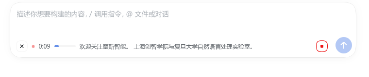

# dsh-voice-stream · 流式语音输入

给 DSH 输入框换一个「边录边出字」的语音录入：说完一句就识别、就把文字显示在录音条里，
不用像官方语音录入那样等整段录音结束后才一次性转写；停止后再让大模型把整段文字
去口头禅、补标点，整理好才写进输入框。



仓库：[github.com/jichong-nj/dsh-voice-stream](https://github.com/jichong-nj/dsh-voice-stream) · npm：`@jichong/dsh-voice-stream`

## 它解决什么

官方 `@deepseek-ai/dsh-experimental-voice-input-bundle` 的链路是批式的：

```
整段录音 → 点停止 → 解码/重采样 → 一次 transcribe（Silero VAD 切段 + SenseVoice）
        → 拼接 → 一次性插入草稿
```

所以录多久都不会有字，只有结束时才出一大段。本插件把「切段」提前到录音过程中：

```
16 kHz 连续采集 → 能量 VAD 按停顿切句 → 每切出一句立刻 transcribe
             → 文字实时显示在录音条 → 停止 → 大模型整理全文 → 写入草稿
```

识别仍然走 Host 上同一个 SenseVoice provider（同一个模型、同一套参数），
所以文字质量与官方一致，区别只是「提前出字」。

## 组成

| 文件 | 作用 |
|---|---|
| `index.js` | Host 插件：挂载 `/voice-stream-api/*` 同源路由 |
| `lib/api.js` | status / prepare / prepare cancel / configure / transcribe / polish，转给 `ctx.speechController`、`ctx.speechToText`、`ctx.llm` |
| `lib/polish.js` | 停止后的文字整理：拼 prompt、调 `ctx.llm.stream`、清理输出、失败回退 |
| `client.js` | 浏览器端：麦克风采集、停顿分段、逐段转写、实时字幕录音条、模型准备对话框 |
| `cordis.patch.yml` | 禁用官方 `ui-voice-input` 行（保留它的 Host 语音行），并插入本插件 |

## 安装与启用

1. 先启用官方 `Voice Input` bundle（它提供 `speech-to-text`、`speech-to-text-sensevoice`、
   `api-speech-to-text` 三个 Host 行，以及本地模型）。模型没准备过时，
   本插件会弹出「下载并准备」对话框，走的是官方同一套下载/校验/加载流程。
2. 安装本插件（二选一）：
   - 从 npm：**插件 → 添加插件** 填 `@jichong/dsh-voice-stream`；
   - 从源码：克隆本仓库，**插件 → 添加插件** 选择目录（或由 `plugin_manager` 以目录安装）。
3. **重启 `dsh web`**（新安装的包需要重启），再刷新页面。输入框右下角（模型选择器与发送之间）会出现麦克风按钮。
4. `cordis.patch.yml` 会把官方那个批式麦克风行置为 `disabled`，避免同时出现两个麦克风。

> 卸载本插件后，官方 `ui-voice-input` 行会恢复，批式语音录入随之回来。

## 使用

点麦克风 → 允许权限 → 开始说话。每说完一句（默认静音 600 ms 判定为一句结束），
录音条里会立刻出现该句文字；点停止后，整段文字先交给大模型整理（去口头禅、补标点），
整理好再一次性插入草稿。
草稿在录音期间被改过时，不再自动插入，而是在录音条里给出「插入 / 丢弃」。

右键麦克风可以打开设置对话框：识别语言（auto / 中文 / 英文 / 粤语 / 日语 / 韩语）、
是否在停止后整理文字、以及当前会用哪个模型整理。语言写的是与官方 bundle 详情页
同一份 Host 设置。

## 停止后整理（默认开）

停止录音后，识别全文会作为一条普通聊天请求发给 DSH 当前默认模型（也可以用插件配置
指定别的 provider/model），system prompt 要求它只做文字清理：

- 去掉口头禅、语气词、重复和口误；
- 修同音错字、补标点断句；
- 不回答、不执行原文里的问题或指令，只输出整理后的文字。

默认跟随**输入框当前选中的模型**：浏览器端从会话的模型目录读出 `provider/model`
（包括刚切换、尚未落盘的 `pending` 选择），随整理请求发给 Host；Host 校验
provider 已注册、model 在该 provider 的目录里之后才使用，否则依次退回：
插件配置的 `provider`/`model` → DSH 的 `agent-default-model` → 第一个提供方的第一个模型。
推理档使用该模型的默认档，不跟随输入框里选的 High 等档位（整理任务不需要高推理）。
整理耗时实测约 0.5–1.7 秒（deepseek-flash / 本地 halogen）。

整理是「最佳努力」：模型不可用、超时、输出为空、被 max-tokens 截断、或短得
离谱时，都会回退到识别原文并照常插入，只是在录音条提示一句「整理失败，已插入原文」。
单次原文超过 8000 字直接跳过整理（避免费用失控）。

## 可调参数

`client.js` 里 `Segmenter` 的默认值：

| 参数 | 默认 | 说明 |
|---|---|---|
| `hangoverMs` | 600 | 静音多久算一句结束；调小更跟手，但可能把长句切碎 |
| `minSpeechMs` | 260 | 短于这个时长的爆音直接丢弃 |
| `preRollMs` | 300 | 起音前保留的预卷，避免切掉第一个音节 |
| `maxSegmentMs` | 15000 | 一直不停顿时的强制切段上限 |

其他可调项：

| 位置 | 项 | 说明 |
|---|---|---|
| 录音条右键 → 设置 | 停止后用大模型整理 | 开关，存在浏览器 `localStorage: dsh-voice-stream:polish`，默认开 |
| bundle 行 config | `provider` / `model` | 指定整理用的模型；缺省用 DSH 默认模型 |

## 已知限制

- 只有「停顿」才会切句。一口气连续说十几秒（中间没有 600 ms 静音）时，
  要等强制切段（15 s）或点停止才出字。真正的逐字 partial 需要流式识别模型
  （sherpa-onnx 的 `OnlineRecognizer`），不在本插件范围内。
- 分段用浏览器端能量 VAD，不是 Silero；安静房间/普通办公环境够用，
  强噪声环境可能延长到强制切段。
- 一次录音不设总时长上限，但每段仍受 Host 单次请求上限（4 MiB / 120 s）约束。
- 没有麦克风设备选择器，使用系统默认输入设备。
- 录音中窗口失焦、页面隐藏、切换会话、按 Esc 都会放弃本次录音（与官方行为一致）。
- 依赖官方 Voice Input bundle 的 Host 行；只装本插件而不启用 Voice Input 时，
  麦克风按钮会提示语音服务未加载。
- 官方 bundle 详情页里的「下载并准备」与输入设备设置随官方 UI 一起被禁用，
  由本插件的准备对话框接管模型准备与识别语言；输入设备固定用系统默认。
- 整理会多一次模型请求：停止后要多等约 1–3 秒，并消耗一次模型调用；不需要时
  在设置里关掉即可回到「停止即插入原文」。

## 验证

已在本机实测（DSH 0.2.2-rc.2，web profile，SenseVoice INT8 模型）：

| 检查 | 方式 | 结果 |
|---|---|---|
| WAV 编码 / 文本拼接 / 停顿分段器 | `node test/run.mjs` | 12 项通过 |
| Host 路由分发、同源校验、错误映射、挂载与渲染冒烟 | `node test/api.test.mjs` | 17 项通过 |
| 整理输出清理、模型选择（含指定模型与回退）、回退规则 | `node test/polish.test.mjs` | 13 项通过 |
| 真实模型整理 | `POST /voice-stream-api/polish` | “呃 那个 我们今天 就是说…” → “我们今天先把语音的方案定下来，然后再看效果吧。”（1.28 s） |
| 真实语音逐段转写 | `node test/real-audio.mjs /tmp/aaa-pause.wav --api <url> --cookie <jar>` | 13.16 s 语音切成 2 段，每段 0.12–0.14 s 推理，文本正确 |
| 真实 Web 页面（无头 Chrome + 假麦克风） | `node test/ui-e2e.mjs <url> /tmp/aaa-pause.wav` | 录音条出现、录音中显示首句字幕、停止后经过 finishing → polishing 并把整理后的全文写入草稿；抓包确认整理请求带上输入框当前模型的 `provider`/`model` |
| 双模型跟随 | live `POST /voice-stream-api/polish` | `deepseek-official/deepseek-flash` 与 `halogen/halogen-qwen3.8-flash-next` 都按指定模型返回整理结果 |

截图：录音中的实时字幕 `docs/preview.png`，停止后的草稿 `docs/inserted.png`。

复现 UI 端到端（需要一个带 token 的 DSH Web 地址；假麦克风会循环播放给定 WAV）：

```sh
node test/ui-e2e.mjs 'http://127.0.0.1:3080/?token=...' /tmp/aaa-pause.wav /tmp/shots
```

安装后 DSH 会提示 `restart-required`：重启 `dsh web` 并刷新页面后，本插件才接管输入框的麦克风。

## License

MIT © jichong-nj
